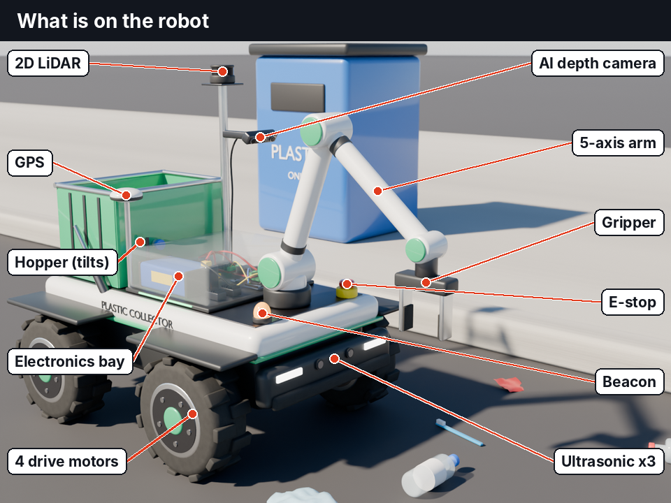
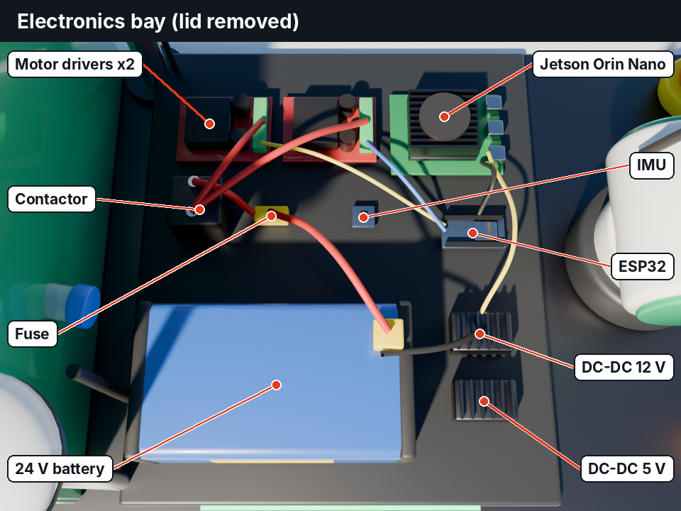

# Plastic Collector Robot

A concept for a small autonomous rover that finds plastic litter on roads and open ground, picks it up with an arm, and empties it into roadside plastic collector boxes.

**Status: concept only.** Everything here is a 3D model, an animation and a paper design. Nothing has been built or tested yet. The plan is to build the first prototype in Hyderabad.

Video: [media/plastic_collector_robot_explainer.mp4](media/plastic_collector_robot_explainer.mp4)

## How it works

1. A depth camera and an AI model spot plastic on the ground: bottles, carry bags, wrappers, brushes, cups.
2. A LiDAR and three ultrasonic sensors watch for people and obstacles. The robot slows or stops when someone is close.
3. The robot drives up to the item and the arm picks it.
4. The arm drops the item into the hopper on the back.
5. When the hopper is full, GPS guides the robot to the nearest collector box.
6. The hopper tilts and empties.

## How many axes

- **Arm: 5 axes** (base turn, shoulder, elbow, wrist tilt, wrist roll) plus a two-finger gripper.
- **Drive: 4 motors**, one per wheel, steered by speed difference (skid steer).
- **Hopper: 1 linear actuator** for tilting.

## Electronics

| Part | Job |
|---|---|
| Jetson Orin Nano | Runs plastic and people detection and route planning |
| ESP32 | Real-time control of motors, servos and sensors |
| Motor drivers x2 (30 A) | Drive the four wheel motors |
| 24 V 20 Ah LiFePO4 battery | Main power |
| DC-DC 24 V to 12 V | Jetson, arm, hopper actuator |
| DC-DC 24 V to 5 V | ESP32, sensors, lights |
| Fuse and contactor | The E-stop cuts motor power only, so the computer stays on |
| IMU | Tilt and heading |

Wiring: [docs/wiring_diagram.png](docs/wiring_diagram.png)

## Cost

About **Rs 2.5 to 3.0 lakh** for one prototype, including a 10% spare margin. Three prices were checked online; the rest are estimates. Full list: [docs/BOM.md](docs/BOM.md) and [docs/bom.csv](docs/bom.csv).

## Runtime and charging (estimates)

- 24 V 20 Ah battery: about 3 to 4 hours with the arm only.
- With a suction unit running: about 1 hour. A 60 Ah battery would give about 3 hours.
- Charging: 3 to 4 hours from a normal 230 V socket.

## Still to add

- Bumper contact switch and wheel encoders
- Hopper-full sensor
- Buzzer or speaker to warn people nearby
- Remote control for manual override
- Rain-proof (IP65) box and cooling for the electronics
- Charging dock
- Battery level monitor
- Suction unit for small pieces of 1 to 5 mm (later version)

## Known limits

- The detection picture in `media/camera_view_illustration.png` is an illustration. No model has been trained yet. The free TACO litter dataset is the planned starting point.
- Crushed, wet or half-buried plastic is hard for a gripper. Expect many failed picks at first.
- This prototype is for parks, campuses and footpaths. Open roads with traffic need a weatherproof, road-safe design that costs several times more.
- Plastic smaller than 1 mm mixed into soil cannot be separated by this robot.

## Similar work

- Angsa Robotics (Germany): AI litter-picking robot for parks.
- BeachBot (Netherlands): beach rover for small litter.
- Ramudroid (India): road-litter robot project using brushes.

## Files

- `blender/PlasticCollectorBot.blend`: the 3D model with the pick-and-drop animation (Blender 5.2).
- `media/`: renders and the explainer video.
- `docs/`: parts list, cost estimate and wiring diagram.

## Building it in Hyderabad

T-Works in Raidurg is a government prototyping centre with a metal shop, 3D printing, laser cutting and an electronics lab. Access is through paid passes. Check its current rate card before budgeting.
